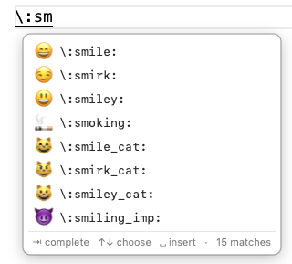
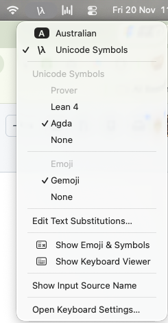

# Unicode Symbols Input

A macOS input method for typing symbols by name in any app: `\to` → `→`, `\all` → `∀`,
`\:tada:` → 🎉. As you type, a list shows every command that starts with what you've typed, so
you can see whether it will work, and **Tab** completes.




It comes with symbol sets in two classes. You use one set from each class (or none):

| Class  | Sets                                                     | Examples                     |
|--------|----------------------------------------------------------|------------------------------|
| Prover | **Lean 4** (default), Agda                               | `\to` →, `\all` ∀, `\N` ℕ (Lean) / `\bN` ℕ (Agda) |
| Emoji  | **Gemoji** (default): GitHub's emoji shortcodes          | `\:smile:` 😄, `\:+1:` 👍     |

Sets from different classes never share a command, so emoji can't get in the way of prover
symbols. [ARCHITECTURE.md](ARCHITECTURE.md) explains the rules and how the input method works.

## Build and install from source

Unicode Symbols Input is installed by building it on your own Mac. It takes about a minute.

### 1. Requirements

- macOS 12 (Monterey) or later, on Apple silicon or Intel.
- The Xcode Command Line Tools, which provide the Swift compiler. The full Xcode app is not
  needed. Install them with:

  ```sh
  xcode-select --install
  ```

  and check they work:

  ```sh
  swiftc --version
  ```

### 2. Get the source

```sh
git clone git@github.com:x100proof/UnicodeSymbolsInput.git
# or, without an SSH key set up for GitHub:
git clone https://github.com/x100proof/UnicodeSymbolsInput.git
cd UnicodeSymbolsInput
```

### 3. Build and install

```sh
./install.sh                       # Lean 4 + Gemoji (the defaults)
./install.sh --prover agda         # Agda + Gemoji
./install.sh --emoji none          # Lean 4, no emoji
./install.sh --prover agda --emoji none
```

`--prover` takes `lean4`, `agda` or `none`; `--emoji` takes `gemoji` or `none`. Your choice is
remembered, so later runs without these options keep it.

`install.sh`:

1. runs the test suite (including the check that no command is shared between classes),
2. builds the input method and the `usi-ctl` tool into `build/`,
3. copies `UnicodeSymbolsInput.app` to `~/Library/Input Methods` (for your user only; no
   administrator password needed), stopping any running older copy, and
4. registers and enables it as an input source.

### 4. Start using it

1. Click the input menu in the menu bar (the flag or letter icon) and choose
   **Unicode Symbols**. If there is no input menu, turn on System Settings → Keyboard →
   Text Input → Input Sources → Edit… → **Show Input menu in menu bar**.
2. If Unicode Symbols isn't listed, log out and back in once; macOS sometimes only notices a
   new input method at login.
3. Type `\to` then Space in any text field to get `→`.

### Updating

```sh
cd UnicodeSymbolsInput
git pull && ./install.sh
```

### Building without installing

```sh
./build.sh          # tests, then build/UnicodeSymbolsInput.app and build/usi-ctl
./build.sh test     # tests only
```

### Troubleshooting

- **`swiftc: command not found`** or **`xcrun: error: invalid active developer path`**: the
  Command Line Tools are missing or broken. Run `xcode-select --install` and try again.
- **"Input source: not registered"** from `build/usi-ctl status`, or **Unicode Symbols isn't in
  the input menu**: log out and back in. If it still isn't there, add it by hand: System
  Settings → Keyboard → Text Input → Input Sources → Edit… → **+** → **English** →
  **Unicode Symbols**.
- **Typing `\to` does nothing**: check that Unicode Symbols (the `\λ` icon) is the selected
  input source in the input menu.

## Typing

| Key              | Does                                                                   |
|------------------|------------------------------------------------------------------------|
| `\` + name       | start a command; suggestions appear                                    |
| Tab / ⇧Tab, ↓ / ↑ | complete: step through the suggestions                                |
| Space            | insert the highlighted symbol and a space (your text as typed if none is highlighted) |
| Return           | the same, without the space                                            |
| `\`              | insert, and start the next command (`\to\to` → `→→`)                   |
| `\\`             | a literal backslash                                                    |
| Delete           | remove a character; on a bare `\`, cancel                              |
| Esc              | keep your text as typed                                                |

## Switching sets

From the input menu (the Unicode Symbols icon in the menu bar), tick a set under each class.
One set per class is ticked at a time; choose None to switch a class off.



Or from the terminal:

```sh
build/usi-ctl status            # classes, sets, and which are active
build/usi-ctl use prover agda
build/usi-ctl use emoji none
```

Changes apply from the next text field you click into, and are kept across reinstalls.

## Updating the symbol data

```sh
scripts/update-sets.py          # all sets; or name some: scripts/update-sets.py gemoji
./build.sh test                 # must pass: checks no command is shared between classes
./install.sh
```

## Uninstall

From the source checkout:

```sh
./install.sh --uninstall
```

This disables the input source and deletes `~/Library/Input Methods/UnicodeSymbolsInput.app`.
Your set choices stay in the preferences domain `org.100proof.inputmethod.UnicodeSymbolsInput`;
run `defaults delete org.100proof.inputmethod.UnicodeSymbolsInput` to forget them too.

## Packaging (maintainers)

`./package.sh` builds `build/UnicodeSymbolsInput-<version>.pkg`: a universal (Apple silicon +
Intel) build that installs into `/Library/Input Methods` for all users and registers itself for
the logged-in user. It is **unsigned** and not currently distributed; building from source
above is the supported way to install. A package and a source install shouldn't be installed
side by side, since both use the same bundle id.

To ship signed, notarized packages later, set these before running `./package.sh`:

| Variable                  | Effect                                                           |
|---------------------------|------------------------------------------------------------------|
| `APP_SIGN_IDENTITY`       | codesign the app with this *Developer ID Application* identity (hardened runtime) |
| `INSTALLER_SIGN_IDENTITY` | sign the .pkg with this *Developer ID Installer* identity        |
| `NOTARY_PROFILE`          | notarize with `xcrun notarytool` (a stored keychain profile) and staple the ticket |

## Credits

- Inspired by [Math Symbols Input](https://github.com/knrafto/MathSymbolsInput) by Kyle
  Raftogianis. This is a separate implementation, written from scratch.
- Lean 4 abbreviations from [leanprover/vscode-lean4](https://github.com/leanprover/vscode-lean4)
  (Apache License 2.0).
- Agda abbreviations from [banacorn/agda-mode-vscode](https://github.com/banacorn/agda-mode-vscode)
  (MIT), generated from Agda's `agda-input.el`.
- Emoji shortcodes from [github/gemoji](https://github.com/github/gemoji) (MIT).

The licence texts for the bundled data are in `Sets/licenses/`.

## Licence

MIT, see [LICENSE](LICENSE). The bundled symbol data keeps its own licences (above).
